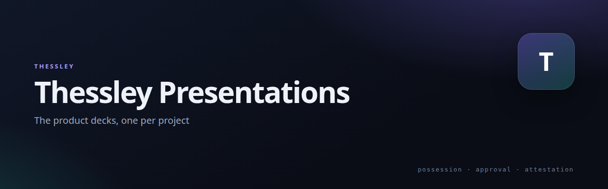

# Thessley Presentations


[](https://netmate1234.github.io/thessley-presentations/)

The product decks, one per project. Arrow keys or click the edges; `#7` deep-links a slide.

## Decks

| Project | Deck |
|---|---|
| Thessley (overview, 13 slides) | https://netmate1234.github.io/Thessley/ |
| PAM for Linux | https://netmate1234.github.io/thessley-pam-linux/ |
| PAM for Windows | https://netmate1234.github.io/thessley-pam-windows/ |
| Passkey for Linux | https://netmate1234.github.io/thessley-passkey-linux/ |
| Passkey server | https://netmate1234.github.io/thessley-passkey-server/ |

## Run locally

```sh
python3 -m http.server -d <repo>/docs 8000
# http://127.0.0.1:8000/
```

Print to PDF with `google-chrome --headless --no-pdf-header-footer --print-to-pdf=deck.pdf <url>`.

## Related

- [Thessley](https://github.com/netmate1234/Thessley)
